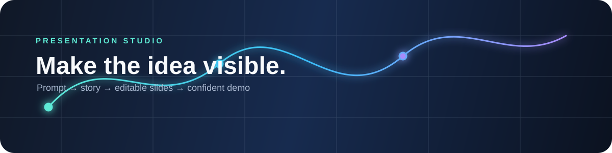
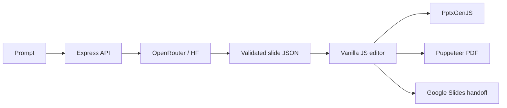

<div align="center">
  

  <h1>✦ PPTgeni</h1>
  <p><strong>From a rough idea to a presentation people remember.</strong></p>
  <p>AI-assisted storytelling, hackathon-ready themes, editable slide structure, and real PPTX/PDF exports.</p>

  <p>
    <a href="https://github.com/LovelySharma-dev/PPTgeni"></a>
    <a href="https://github.com/LovelySharma-dev/PPTgeni/blob/main/LICENSE"></a>
    <a href="https://nodejs.org/"></a>
  </p>
</div>

## Why PPTgeni?

Most prompt-to-slide tools produce a wall of text or a flat image. PPTgeni treats a deck as a **structured, editable story**:

```text
natural-language brief
        ↓
story + slide plan
        ↓
trusted slide JSON
        ↓
live editor → PPTX / PDF / Google Slides handoff
```

It is designed for technical demos, hackathons, startup pitches, research talks, project reviews, and fast iteration before a deadline.

## ✨ What you can do

| Area | Included |
| --- | --- |
| Generate | Prompt-to-deck generation with OpenRouter free models, DeepSeek choices, and local fallback |
| Edit | Slide selection, title/body editing, add/remove slides, undo/redo |
| Design | Hackathon neon, terminal green, demo day, electric blue, academic, editorial, and dark themes |
| Build | Add text blocks, shapes, dividers, charts, image URLs, and video placeholders |
| Export | Editable `.pptx` via PptxGenJS and presentation PDF via Puppeteer |
| Share | Google Slides handoff button and Render deployment blueprint |
| Safety | Server-side AI keys, trusted slide data, sanitized provider diagnostics |

## 🎬 See it in action

The banner above is an animated SVG stored in the repository, so the project page does not depend on a third-party image host. For a full product walkthrough, run the app locally and record the prompt-to-export flow:

```powershell
cd D:\PPTgeni
npm install
npm start
```

Open [http://localhost:3000](http://localhost:3000), choose a free model, enter a prompt such as:

> Create a 7-slide tech hackathon pitch for a privacy-first campus safety assistant. Include the problem, users, architecture, demo flow, impact, roadmap, and a memorable closing.

## 🧠 AI provider chain

PPTgeni uses a resilient provider order:

```text
OpenRouter selected model
        ↓ if unavailable
Hugging Face fallback
        ↓ if unavailable
deterministic local generator
```

The landing page loads OpenRouter's current zero-price catalog from `/api/models`, prioritizes DeepSeek free variants, and keeps compatibility entries for common `:free` models.

Create `.env` locally from `.env.example`. Never commit it:

```env
AI_API_URL=https://openrouter.ai/api/v1/chat/completions
AI_API_KEY=your_openrouter_key
AI_MODEL=openrouter/free
```

## 🏗️ Architecture



The model never supplies executable browser JavaScript. It returns data; trusted components render that data. This makes the editor easier to validate and keeps export behavior deterministic.

## 🚀 Render deployment

The repository includes [`render.yaml`](render.yaml). In Render, choose **New → Blueprint**, connect this repository, and add:

- `AI_API_KEY` — OpenRouter key
- `AI_FALLBACK_API_KEY` — optional Hugging Face fine-grained token
- `AI_FALLBACK_MODEL` — optional available Hugging Face chat model

GitHub Pages cannot run the Express API, AI calls, or Puppeteer exports. Render is the backend host for the complete application.

## 🧪 Development

```powershell
npm install
npm test
node --check server.js
node --check public/app.js
npm start
```

## 🗺️ Roadmap

- Drag-and-drop element positioning
- Uploads for images, PDFs, PPTX, and research papers
- Editable chart data tables
- Speaker notes and rehearsal mode
- Research mode with traceable citations
- Google Drive OAuth import/export
- Collaboration and version history

## License

MIT. Built for fast-moving teams that would rather spend their time improving the idea than wrestling with slide formatting.
